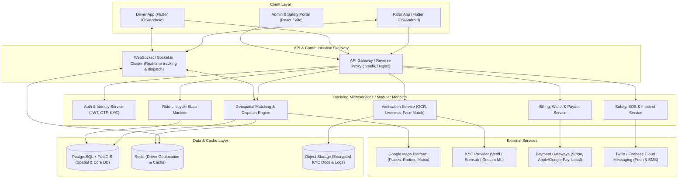
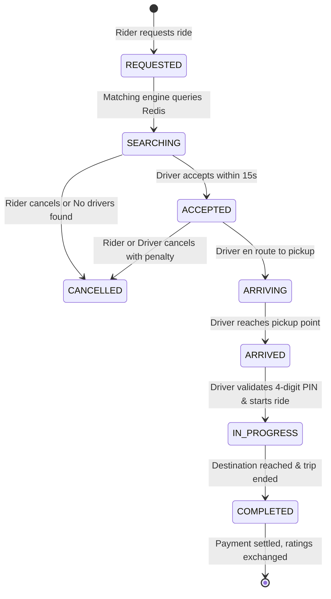

# Uper Girl (Women-Centric Ride-Hailing Platform)
## Comprehensive Project Specification & System Architecture

---

## 1. Executive Summary & Product Vision

### 1.1 Overview
**Uper Girl** is an on-demand, safe mobility platform designed specifically to empower and protect women. It provides ride-hailing services connecting **female passengers** with **verified female drivers**, with robust gender and identity verification protocols to ensure safety, trust, and peace of mind for all participants.

### 1.2 Core Value Proposition
- **Guaranteed Women-to-Women Ride Matching**: Strict verification ensures both parties in a ride are authenticated female users.
- **Safety-First Mobility Ecosystem**: Real-time GPS tracking, trusted contact ride sharing, in-app emergency SOS, audio recording during rides, and number masking.
- **Economic Empowerment**: Safe, flexible earning opportunities for female drivers with community support, fair commission rates, and safety-screened passengers.

---

## 2. The Female Authentication & Verification Pipeline

The standout feature of Uper Girl is its multi-layered identity and gender authentication system. Identity verification must be accurate, respectful, privacy-preserving, and fraud-resistant.

```
       [ User Registration ]
                 │
      ┌──────────┴──────────┐
      ▼                     ▼
[ Rider Onboarding ]  [ Driver Onboarding ]
      │                     │
      │ 1. Phone OTP        │ 1. Phone OTP & Email
      │ 2. Govt ID Upload   │ 2. Govt ID + Driver's License
      │ 3. 3D Liveness Cam  │ 3. Vehicle Reg & Insurance
      │                     │ 4. 3D Liveness Cam Check
      └──────────┬──────────┘
                 ▼
    [ AI Verification Engine ]
     - OCR Document Gender & Name extraction
     - Facial Liveness (Anti-Spoofing: blink/smile)
     - 1:1 Face Match (ID photo vs Live Selfie)
     - Automated Gender Estimation Cross-Check
                 │
      ┌──────────┴──────────┐
      ▼                     ▼
 (Confidence >= 95%)   (Low Confidence / Ambiguous)
      │                     │
      ▼                     ▼
 [ Auto-Approved ]     [ Manual Admin Review Queue ]
                       (Dedicated Female Safety Team)
```

### 2.1 Multi-Stage Verification Architecture

#### Stage 1: Document OCR & Legal Sex/Gender Verification
* **Government ID**: National ID card, passport, or driver's license upload.
* **Automated OCR & Data Extraction**: Extracts legal full name, date of birth, document expiry, and legal sex/gender marker where present on national documents.
* **Document Authenticity Check**: Verifies holograms, MRZ (Machine Readable Zone), barcodes, and document tamper detection.

#### Stage 2: 3D Biometric Liveness & Face Matching
* **Active/Passive Liveness Detection**: User performs micro-actions (blinking, head turn) to prevent photo/video spoofing or deepfakes.
* **1:1 Face Comparison**: Validates that the person holding the phone matches the photo on the legal government ID.
* **AI Gender Estimation Cross-Check**: High-confidence biometric assessment as a secondary validation layer.

#### Stage 3: Human Review Queue (Safety Team)
* Any profile with mismatched document data, unclear photos, or edge cases is routed to a **Human-in-the-Loop (HITL) review queue** managed by a trained female safety team.
* Driver onboarding always requires an additional human manual check (criminal background check, vehicle inspection, driving record).

#### Stage 4: Anti-Account-Sharing & Shift Verification (Critical for Drivers)
* **Pre-Shift "Random Liveness Selfie"**: Before a driver can toggle **Online**, the app prompts a quick biometric selfie verification to guarantee the registered female driver is behind the wheel (preventing husbands, brothers, or male friends from operating the account).
* **Rider Pickup Photo / PIN Code**: 4-digit PIN verification before trip start ensures the rider who ordered is the rider boarding the vehicle.

---

## 3. Platform Actor Roles & Permissions

| Role | Access Level | Responsibilities & Capabilities |
| :--- | :--- | :--- |
| **Female Rider** | Mobile App | Search destinations, view fare estimates, request rides, view verified driver details, track trip live, share trip link, trigger SOS, pay and rate. |
| **Female Driver** | Mobile App | Submit onboarding docs, undergo vehicle checks, toggle Online/Offline, view incoming requests with pickup ETA & route, accept/decline, navigate, complete trips, view earnings & wallet. |
| **Safety Operator** | Web Dashboard | Monitor active SOS alerts, listen to live audio or call emergency contacts, review pending KYC verifications, audit flagged rides. |
| **Super Admin** | Web Dashboard | Platform analytics, dynamic pricing configuration, dispute resolution, driver payout management, platform policy configuration. |

---

## 4. System Architecture & High-Level Design



---

## 5. Core Feature Specifications

### 5.1 Rider Application
1. **Interactive Map & Geolocation**: Automatic pickup pin, reverse geocoding, saved places (Home, Work, Frequent).
2. **Ride Selection & Fare Estimation**:
   * Upfront pricing calculated using base fare, distance (km), estimated time (min), and dynamic demand multiplier.
   * Vehicle categories (e.g., *Pink Economy*, *Pink Comfort*, *Pink XL*).
3. **Driver Profile & Verification Badge**:
   * Displays driver's verified badge, photo, vehicle make/model/color, license plate, rating, and total completed rides.
4. **Live Trip Tracking**:
   * 60fps smooth driver car icon movement on map.
   * Turn-by-turn ETA updates.
5. **In-Trip Safety Suite**:
   * **SOS Button**: 1-tap dialer to local emergency services + instant push to Uper Girl safety team + SMS to emergency contacts with live tracking URL.
   * **Share My Trip**: Live web tracking link for family/friends.
   * **In-App Call/Chat**: Masked phone numbers (VoIP) so neither driver nor rider exposes personal mobile numbers.
6. **Payment & Rating**:
   * Card, In-app Wallet, or Cash option.
   * Dual-sided rating & tipping system.

### 5.2 Driver Application
1. **Driver Onboarding Flow**:
   * Document upload wizard: National ID, Driver's License, Vehicle Registration, Vehicle Roadworthiness / Inspection, Insurance, Background Check.
2. **Online / Offline Toggle**:
   * Instant selfie liveness check trigger before shift starts.
3. **Dispatch & Request Radar**:
   * Full-screen incoming request with 15-second countdown timer.
   * Displays pickup location, pickup distance, destination zone, and guaranteed estimated fare.
4. **In-App Turn-by-Turn Navigation**:
   * Built-in Google Maps navigation or deep-link to Waze / Apple Maps / Google Maps.
5. **Trip Execution Workflow**:
   * `Accept` ➔ `Navigate to Pickup` ➔ `Arrived` ➔ `Verify Rider PIN` ➔ `Start Trip` ➔ `End Trip` ➔ `Collect Fare/Receipt`.
6. **Earnings & Analytics**:
   * Daily / weekly earnings graphs, completed trip logs, incentives / surge zone heatmaps, instant cashout to bank account.

### 5.3 Dispatch & Real-Time Geospatial Matching Engine
* **Spatial Indexing**: Geohash or Uber H3 hexagonal spatial indexing.
* **Driver Location Tracking**: Drivers stream lightweight GPS coordinates (`lat`, `lng`, `heading`, `speed`, `timestamp`) every 3–5 seconds over WebSockets into Redis Geospatial (`GEOADD`).
* **Radius Search**:
  1. Rider requests a ride at `(lat, lng)`.
  2. Query Redis for active, online, unoccupied drivers within `radius = 3km` with `gender_verified == true`.
  3. Rank candidate drivers by ETA, acceptance rate, and distance.
  4. Dispatch sequentially (or circular broadcast) to candidate driver.
  5. If driver rejects or times out (15s), dispatch to the next closest driver.

---

## 6. Database Schema & Data Models (PostgreSQL + PostGIS)

### 6.1 Users Table (`users`)
```sql
CREATE TABLE users (
    id UUID PRIMARY KEY DEFAULT gen_random_uuid(),
    phone VARCHAR(20) UNIQUE NOT NULL,
    email VARCHAR(255) UNIQUE,
    full_name VARCHAR(150) NOT NULL,
    avatar_url TEXT,
    role VARCHAR(20) NOT NULL CHECK (role IN ('rider', 'driver', 'admin')),
    gender VARCHAR(10) NOT NULL CHECK (gender = 'female'),
    gender_verified BOOLEAN DEFAULT FALSE,
    verification_status VARCHAR(30) DEFAULT 'unverified' 
        CHECK (verification_status IN ('unverified', 'pending', 'approved', 'rejected')),
    rating_avg NUMERIC(3, 2) DEFAULT 5.00,
    rating_count INT DEFAULT 0,
    emergency_contacts JSONB DEFAULT '[]'::jsonb,
    created_at TIMESTAMPTZ DEFAULT NOW(),
    updated_at TIMESTAMPTZ DEFAULT NOW()
);
```

### 6.2 Driver Details & Vehicles (`driver_profiles`, `vehicles`)
```sql
CREATE TABLE driver_profiles (
    id UUID PRIMARY KEY DEFAULT gen_random_uuid(),
    user_id UUID REFERENCES users(id) ON DELETE CASCADE,
    license_number VARCHAR(100) NOT NULL UNIQUE,
    license_expiry DATE NOT NULL,
    background_check_status VARCHAR(30) DEFAULT 'pending',
    is_online BOOLEAN DEFAULT FALSE,
    is_busy BOOLEAN DEFAULT FALSE,
    last_shift_selfie_at TIMESTAMPTZ,
    total_earnings NUMERIC(10, 2) DEFAULT 0.00,
    created_at TIMESTAMPTZ DEFAULT NOW()
);

CREATE TABLE vehicles (
    id UUID PRIMARY KEY DEFAULT gen_random_uuid(),
    driver_id UUID REFERENCES driver_profiles(id) ON DELETE CASCADE,
    make VARCHAR(50) NOT NULL,
    model VARCHAR(50) NOT NULL,
    year INT NOT NULL,
    color VARCHAR(30) NOT NULL,
    license_plate VARCHAR(20) NOT NULL UNIQUE,
    vehicle_type VARCHAR(30) DEFAULT 'economy', -- economy, comfort, xl
    insurance_policy_number VARCHAR(100),
    insurance_expiry DATE,
    inspection_passed BOOLEAN DEFAULT FALSE
);
```

### 6.3 Verifications Log (`user_verifications`)
```sql
CREATE TABLE user_verifications (
    id UUID PRIMARY KEY DEFAULT gen_random_uuid(),
    user_id UUID REFERENCES users(id) ON DELETE CASCADE,
    document_type VARCHAR(50) NOT NULL, -- national_id, passport, drivers_license
    document_front_url TEXT NOT NULL,
    document_back_url TEXT,
    selfie_url TEXT NOT NULL,
    extracted_gender VARCHAR(20),
    liveness_score NUMERIC(5, 2),
    face_match_score NUMERIC(5, 2),
    ai_decision VARCHAR(30), -- pass, fail, manual_review
    manual_reviewer_id UUID REFERENCES users(id),
    rejection_reason TEXT,
    verified_at TIMESTAMPTZ
);
```

### 6.4 Rides & Trips (`rides`)
```sql
CREATE TABLE rides (
    id UUID PRIMARY KEY DEFAULT gen_random_uuid(),
    rider_id UUID REFERENCES users(id),
    driver_id UUID REFERENCES driver_profiles(id),
    vehicle_id UUID REFERENCES vehicles(id),
    status VARCHAR(30) NOT NULL DEFAULT 'requested'
        CHECK (status IN (
            'requested', 'searching', 'accepted', 
            'arriving', 'arrived', 'in_progress', 
            'completed', 'cancelled'
        )),
    pickup_address TEXT NOT NULL,
    pickup_location GEOMETRY(Point, 4326) NOT NULL,
    dropoff_address TEXT NOT NULL,
    dropoff_location GEOMETRY(Point, 4326) NOT NULL,
    route_polyline TEXT,
    estimated_distance_km NUMERIC(6, 2),
    estimated_duration_min INT,
    estimated_fare NUMERIC(10, 2),
    final_fare NUMERIC(10, 2),
    pin_code VARCHAR(4),
    cancellation_reason TEXT,
    cancelled_by UUID REFERENCES users(id),
    started_at TIMESTAMPTZ,
    completed_at TIMESTAMPTZ,
    created_at TIMESTAMPTZ DEFAULT NOW()
);
CREATE INDEX idx_rides_pickup_location ON rides USING GIST(pickup_location);
```

---

## 7. Ride Lifecycle State Machine



---

## 8. Safety & Compliance Guardrails

1. **Child & Male Passenger Policy**:
   * Platform policy specification: Riders can travel solo or with other female companions and young children (e.g. boys under 12). Clear in-app guidelines educate riders on companion policies.
2. **Live Incident Detection & Telematics**:
   * Backend monitors trip deviation: If a vehicle stops unexpectedly for > 5 minutes or deviates > 30% from the navigation route, the safety bot sends an automated in-app prompt ("Are you okay?").
3. **Data Privacy & Encryption**:
   * Government IDs and verification selfies are stored in private, AES-256 encrypted object storage with time-limited signed URLs. Documents are accessible exclusively to authorized KYC compliance officers.

---

## 9. Technology Stack Recommendation

| Layer | Recommended Technology | Rationale |
| :--- | :--- | :--- |
| **Mobile Apps** | **Flutter** (Dart) | Single codebase for iOS and Android, native performance, rich map/animation support, fast time-to-market. |
| **Admin Dashboard** | **React + Tailwind CSS / Vite** | Fast, responsive, component-driven UI for safety monitoring and KYC audits. |
| **Backend Framework** | **NestJS (Node.js / TypeScript)** or **Go** | Modular architecture, enterprise TypeScript typing, built-in WebSocket support, fast execution. |
| **Database** | **PostgreSQL with PostGIS** | The gold standard for geospatial queries (`ST_DWithin`, spatial indexes), relational integrity, ACID compliance. |
| **Real-time & Caching** | **Redis (GEO & Pub/Sub) + Socket.io** | Sub-millisecond latency for driver location updates and high-frequency dispatch pings. |
| **Maps & Routing** | **Google Maps Platform** | Best-in-class Places Autocomplete, Routes API, and Map SDK for mobile. |
| **Biometric & KYC** | **Veriff / Sumsub / AWS Rekognition** | Turnkey OCR + 3D liveness detection + face match compliance with high accuracy. |

---

## 10. Phased Implementation Roadmap

### Phase 1: Foundation & KYC Verification Engine (Weeks 1–3)
* Repository setup, PostgreSQL + PostGIS database configuration, authentication services (OTP).
* Identity & Gender verification pipeline (Document OCR + 3D Liveness selfie + Admin Approval Dashboard).
* Base Flutter project setup with role-based routing (Rider vs. Driver mode).

### Phase 2: Driver Onboarding, Vehicle Registration & Maps Integration (Weeks 4–5)
* Driver document upload & vehicle inspection workflow.
* Google Maps integration (interactive map, place search, reverse geocoding, route polylines).
* Real-time GPS driver location broadcasting over WebSockets to Redis.

### Phase 3: Core Ride-Hailing & Dispatch Engine (Weeks 6–8)
* Geospatial matching algorithm (find nearby verified female drivers, send 15s dispatch popup).
* Full ride lifecycle: Request ➔ Accept ➔ Arrive ➔ 4-digit PIN validation ➔ In-Progress ➔ Complete.
* Fare estimation and dynamic receipt generation.

### Phase 4: Safety Suite & Security Features (Weeks 9–10)
* Pre-shift driver biometric selfie check.
* In-app SOS button + emergency contact notification + live shareable trip link.
* Number masking / in-app VoIP calling or chat.

### Phase 5: Payments, Ratings & Launch Preparation (Weeks 11–12)
* Payment gateway integration (Card, Digital Wallets, Cash).
* Dual-sided rating & review system.
* End-to-end integration testing, security audit, and deployment to App Store / Google Play.
