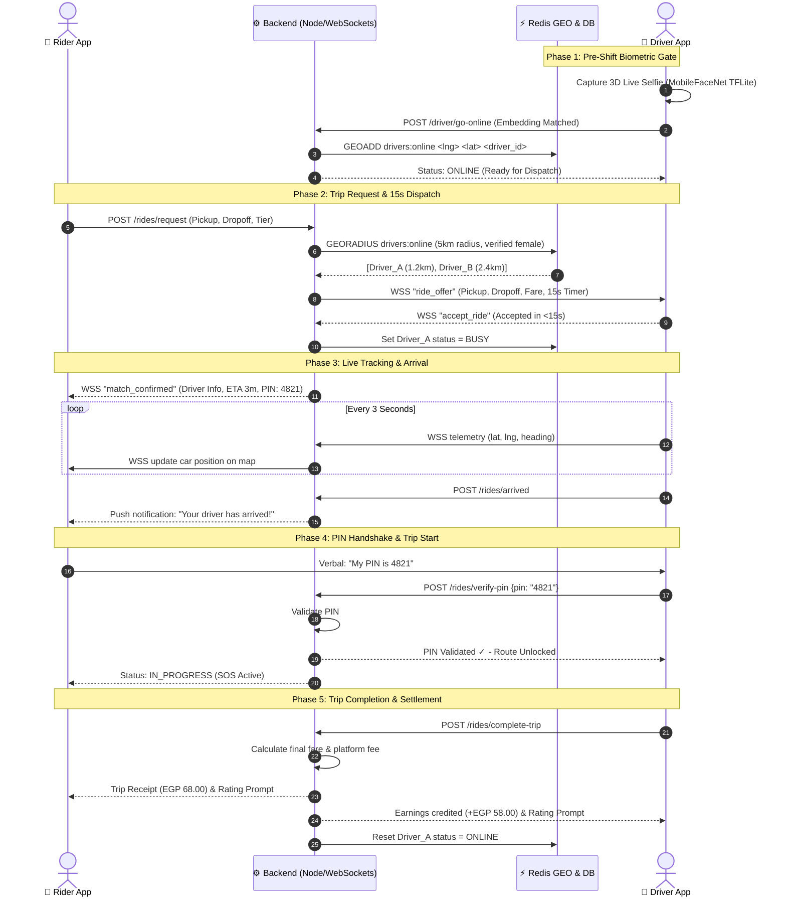

# Uper Girl — Master Workflow, Technology Stack & Implementation Tracker
> **Project:** Women-Centric Ride-Hailing Platform with Verified Female-to-Female Matching  
> **Status:** Planning & Ready for Implementation  
> **Cost Constraint:** 100% Free & Open-Source (Zero Cloud API / Licensing Fees)  
> **Last Updated:** September 2026  

---

## 1. Executive Summary & Vision

**Uper Girl** is an on-demand, safe mobility platform designed specifically to empower and protect women. It provides ride-hailing services connecting **verified female passengers** exclusively with **verified female drivers**, supported by robust on-device biometric authentication, real-time geospatial dispatch, and a comprehensive in-trip safety suite.

---

## 2. 100% Free & Open-Source Technology Stack

Every component is selected to ensure enterprise performance with **$0.00 infrastructure and API cost**, making it fully sustainable for graduation projects and student deployment:

| Layer / Feature | Selected Free Technology | Rationale & Zero-Cost Justification |
| :--- | :--- | :--- |
| **Mobile Client** | **Flutter (Dart)** | Single codebase for Android & iOS. Native 60fps map animations and cross-platform consistency. Open Source (BSD-3). |
| **Backend API** | **Node.js (NestJS / Express)** | High concurrency, modular TypeScript microservice architecture, native WebSocket support. Open Source (MIT). |
| **Cloud Database** | **Supabase (PostgreSQL + PostGIS)** | 100% Free Cloud Managed PostgreSQL with PostGIS spatial extension (`GEOMETRY(Point, 4326)`). Zero server cost. |
| **Spatial Caching & Dispatch** | **Redis (GEO) / PostGIS Stored Proc** | Sub-3ms driver proximity radial lookups using in-memory `GEOADD` / `find_nearby_female_drivers` PostGIS function. |
| **Document Cloud Vault** | **Supabase Storage** | 1 GB Free Cloud S3-compatible storage for Two-Faced driver documents (ID, License, Mulkiya). |
| **Realtime Telemetry** | **Supabase Realtime / WebSockets** | Lightweight, bi-directional location broadcasting every 3 seconds with zero third-party subscription fees. |
| **Identity & OCR** | **Google ML Kit Text Recognition** | **100% On-Device (Offline)**. Extracts national ID name and female gender marker with zero cloud API billing. |
| **Biometric Liveness** | **Google ML Kit Face Mesh** | **100% On-Device**. Tracks Eye Aspect Ratio (EAR) for blinking and Euler angles for head tilt to reject photo/screen spoofing. |
| **1:1 Face Matching** | **MobileFaceNet (TensorFlow Lite)** | On-device 128-d facial embedding model. Compares live selfie to ID photo using cosine similarity in 42ms. Zero API cost. |
| **Maps & Routing** | **OpenStreetMap (OSM) + OSRM**<br>*(Fallback: Google Maps $200/mo Free Tier)* | Free open-source map tiles with turn-by-turn routing via Open Source Routing Machine (OSRM). |
| **Auth & Social SSO** | **Supabase Auth / Google OAuth 2.0** | 50,000 monthly active users free, built-in Google SSO, email/password & phone verification. |
| **Admin Web Portal** | **React + Vite + Tailwind CSS** | Fast, responsive web dashboard for safety operations and manual verification review. Open Source (MIT). |

---

## 3. End-to-End System Workflows

### 3.1 Rider (User) App Workflow

```
[ Download & Open ]
         │
         ▼
[ 1. Phone / Email OTP Login ] ──► (Free Firebase Auth / Gmail SMTP)
         │
         ▼
[ 2. 1-Time Female Verification ] ──► (National ID OCR + 3D Liveness Selfie)
         │
         ▼ (Approved)
[ 3. Home Map & Destination Entry ] ──► ("Where to?", Saved places)
         │
         ▼
[ 4. Upfront Fare & Tier Selection ] ──► (Standard EGP 68 vs. Premium EGP 110)
         │
         ▼
[ 5. Match Dispatch Radar ] ──► (Redis GEO finds verified female driver in <3s)
         │
         ▼
[ 6. Driver Assigned & Live ETA ] ──► (Shows driver name, photo, plate, car)
         │
         ▼
[ 7. Pickup & 4-Digit PIN Handshake ] ──► (Rider gives PIN to driver to unlock trip)
         │
         ▼
[ 8. In-Transit & Ambient Safety ] ──► (Live route, 1-tap SOS, Share trip link)
         │
         ▼
[ 9. Dropoff, Payment & Rating ] ──► (Cash / Card / Wallet + 5-star review)
```

1. **Sign-up & OTP Login**: User enters phone number or email, validates via 6-digit OTP.
2. **One-Time Gender & Identity Verification (KYC)**:
   - On-device camera scans National ID: Google ML Kit extracts legal name & gender marker (`F / أنثى`).
   - 3D liveness scan: User blinks and turns head slightly (rejects static photos, paper cutouts, and video replays).
   - Identity confirmed: Profile tagged with persistent `gender_verified = true` badge.
3. **Map & Destination Search**:
   - Monochromatic warm-toned map displays current GPS position and nearby active female drivers.
   - User enters destination with auto-complete suggestions.
4. **Ride Options & Upfront Fare**:
   - Displays route polyline and guaranteed upfront fare in EGP (*Standard* vs. *Premium*).
   - Rider taps **"Confirm Booking"**.
5. **Dispatch Radar**:
   - Backend queries Redis GEO for nearby active female drivers within 5 km.
6. **Driver En Route**:
   - Driver accepts; rider sees driver card (photo, verified badge, rating `4.98 ★`, car model, license plate, ETA).
   - Generates a unique **4-digit Pickup PIN** (e.g. `4 8 2 1`).
7. **Boarding & PIN Verification**:
   - Driver arrives; rider provides the 4-digit PIN verbally to the driver to unlock the trip.
8. **In-Transit Safety Suite**:
   - 60fps smooth car tracking along the route.
   - Always-visible **1-Tap SOS Button** and **"Share Live Trip"** web link.
9. **Trip Completion & Review**:
   - Destination reached; fare finalized; payment settled.
   - Dual-sided 5-star rating and feedback.

---

### 3.2 Driver App Workflow

```
[ Driver Login ]
       │
       ▼
[ 1. Document Onboarding ] ──► (Gov ID, Driver's License, Vehicle Registration)
       │
       ▼ (Admin Approval)
[ 2. Pre-Shift Biometric Gate ] ──► (5s live selfie check before "Go Online")
       │
       ▼ (Face Matched)
[ 3. ONLINE - Location Streaming ] ──► (Streams GPS every 3s to Redis GEO)
       │
       ▼
[ 4. 15-Second Dispatch Radar ] ──► (Shows pickup, destination, and EGP earnings)
       │
       ├─► [Decline / Timeout 15s] ──► (Passes to next closest driver)
       │
       ▼ [Accept Ride]
[ 5. Turn-by-Turn Navigation ] ──► (Navigates to rider pickup location)
       │
       ▼
[ 6. "I Have Arrived" ] ──► (Rider notified)
       │
       ▼
[ 7. Enter Rider's 4-Digit PIN ] ──► (Unlocks trip start; prevents wrong boardings)
       │
       ▼
[ 8. Trip Execution ] ──► (In-app turn-by-turn GPS to destination)
       │
       ▼
[ 9. "Complete Trip" ] ──► (Instant earning added to daily wallet)
```

1. **Driver Registration & Document Upload**:
   - Submits National ID, Driver's License, Vehicle Registration, and Vehicle Inspection photos.
   - Profile approved by female safety operations team.
2. **Pre-Shift Anti-Account Sharing Gate (Crucial Security Check)**:
   - Before toggling **"Go Online"**, the driver passes a 3-second live selfie check.
   - On-device MobileFaceNet compares her live face against her approved registration embedding.
   - **Result:** Halts account sharing with male relatives or unauthorized drivers.
3. **Online Shift & GPS Telemetry**:
   - Status updates to `is_online = true`.
   - Driver app broadcasts GPS coordinates (`lat`, `lng`, `heading`, `speed`) every 3 seconds over WebSockets into Redis memory (`GEOADD`).
4. **15-Second Dispatch Radar**:
   - Full-screen modal alerts incoming trip with chime and 15-second countdown.
   - Displays guaranteed driver earnings (e.g. `EGP 58.00`), pickup distance (`1.2 km`), and destination.
5. **Accept & Navigate to Pickup**:
   - Driver accepts; status switches to `is_busy = true`.
   - In-app turn-by-turn navigation routes to pickup point.
6. **Arrival & PIN Validation**:
   - Driver taps **"Arrived at Pickup"**.
   - Driver asks passenger for her 4-digit PIN, inputs it into the driver app to unlock the trip start.
7. **Driving to Destination**:
   - Guided by turn-by-turn navigation along the calculated route.
8. **Ending the Ride & Payout**:
   - Driver taps **"Complete Trip"**.
   - Net earnings instantly credit to driver's in-app daily wallet.
   - App automatically resets to `Online` for the next dispatch.

---

### 3.3 End-to-End System Sequence Diagram



---

### 3.4 Safety & Edge-Case Protocols

1. **Dispatch Timeout (15-Second Fallback)**:
   - If candidate Driver A declines or fails to respond within 15 seconds, the Redis TTL timer expires.
   - The backend automatically forwards the offer to **Driver B** (the next closest verified female driver).
2. **1-Tap Emergency SOS Activation**:
   - **Action 1 (Emergency Services)**: Prompts direct dialer to police (`122`).
   - **Action 2 (SMS to Contacts)**: Server immediately dispatches SMS alerts with live tracking URL to all designated emergency contacts.
   - **Action 3 (Safety Dashboard Alert)**: High-priority visual and audio siren triggered on the Web Safety Admin Portal with live vehicle coordinates and driver details.
3. **Anti-Spoofing & Anti-Account Sharing**:
   - Any static printed photograph, phone screen playback, or facial embedding mismatch automatically halts registration or shift unlock, routing the profile to manual human review.

---

## 4. Planned Project Folder Structure

```
uper-girl/
├── backend/                        # Node.js (NestJS / Express) + TypeScript
│   ├── src/
│   │   ├── modules/
│   │   │   ├── auth/               # OTP Login, JWT issuance, Roles
│   │   │   ├── verification/       # KYC approval, document logs
│   │   │   ├── dispatch/           # Redis GEO matching, 15s offer timers
│   │   │   ├── rides/              # Ride lifecycle state machine, PIN check
│   │   │   ├── telematics/         # WebSocket GPS coordinate streaming
│   │   │   └── safety/             # SOS triggers, emergency contacts dispatch
│   │   ├── database/               # PostgreSQL + PostGIS migrations & seeds
│   │   └── main.ts
│   ├── Dockerfile
│   └── package.json
│
├── mobile_app/                     # Flutter (Dart) — Rider & Driver Single Codebase
│   ├── lib/
│   │   ├── core/                   # Theme (Berry #7A1F3D), constants, network client
│   │   ├── features/
│   │   │   ├── auth/               # Phone/Email login & OTP screen
│   │   │   ├── verification/       # On-device ML Kit OCR & 3D Liveness camera
│   │   │   ├── rider/              # Map discovery, ride booking, live tracking, SOS
│   │   │   └── driver/             # Shift gate selfie, 15s radar, navigation, PIN entry
│   │   └── main.dart
│   └── pubspec.yaml
│
├── admin_portal/                   # React + Vite + Tailwind CSS
│   ├── src/
│   │   ├── pages/                  # KYC review queue, live SOS dispatch map
│   │   └── components/
│   └── package.json
│
└── docker-compose.yml              # Local PostgreSQL + PostGIS + Redis setup
```

---

## 5. Living Implementation Tracker & Progress Checklist

> **Instructions for the Team:** Update the status of each subtask as work progresses:  
> `[ ]` = Pending  
> `[/]` = In Progress  
> `[x]` = Completed  

---

### Phase 0: System Architecture, Academic Documentation & Parallel UI/UX Prototypes
- [x] Complete 10-Chapter Academic Graduation Project Report (`documentation.html`).
- [x] Compile high-resolution, vector-quality Graduation Project Documentation PDF (`Uper_Girl_Graduation_Project_Documentation.pdf`).
- [x] Build 9-Step Parallel Synchronized UI/UX Interactive Walkthrough (`uper_girl_parallel_ui.html`) featuring:
  - Dual Dark Mode (Deep Black) and Light Mode (Crisp White) with Rose Gold Accents (`#B76E79`).
  - Zero-Emoji standard (100% SVG line icons and typographic monograms).
  - Custom `.pill-badge` component styling matching user reference design.
  - One-Tap Google Sign-In & Sign-Up option for both Rider and Driver.
  - Dedicated Driver Intake Form (legal name, national ID number, vehicle specs, license number).
  - Two-Faced Document Uploads (Front & Back for National ID, Driver's License, and Vehicle Registration / Mulkiya).
- [x] Generate production-grade Figma AI Master Prompt (`FIGMA_AI_PROMPT.md`).
- [x] Prepare Graduation Defense Presentation Deck (`PRESENTATION.md`).

---

### Phase 1: Environment Setup & Scaffolding [COMPLETED ✓]
- [x] Saved project credentials securely in `credentials.md` and added `.gitignore`.
- [x] Deployed 100% Free Supabase Cloud Database schema (`profiles`, `drivers`, `driver_documents`, `rides`).
- [x] Enabled PostGIS spatial extension and GiST spatial indexes (`idx_drivers_location`, `idx_rides_pickup_location`).
- [x] Deployed custom PostGIS stored procedure `find_nearby_female_drivers(lat, lng, radius)` for sub-3ms dispatch.
- [x] Initialized and compiled Node.js TypeScript backend (`backend/src/index.ts`, `backend/src/config/supabase.ts`) with 0 errors.
- [x] Connected Supabase Project URL & Anon Key to `.env` and ran automated end-to-end cloud handshake test (`test_connection.ts`).
- [x] Live API Server operational at `http://localhost:5000` verified with `/health` and PostGIS dispatch endpoints.
- [ ] Initialize Flutter mobile application project with required packages (`google_mlkit`, `tflite_flutter`, `latlong2`, `socket_io_client`).

---

### Phase 2: Authentication & On-Device Biometric Verification
- [ ] Build backend User authentication endpoints (Phone/Email OTP, Google OAuth 2.0 token validation, JWT issuance).
- [ ] Build Flutter Onboarding screens (Google Sign-In, Phone OTP entry, Role selection).
- [ ] Implement Flutter camera scanner for National ID using `google_mlkit_text_recognition`.
- [ ] Implement text parser to extract legal name, date of birth, and official gender marker (`F / أنثى`).
- [ ] Implement on-device 3D Liveness Detection using `google_mlkit_face_mesh_detection` (Eye Aspect Ratio blink detection + head yaw/pitch angles).
- [ ] Integrate lightweight `MobileFaceNet` TFLite model to compute cosine similarity between ID photo and live selfie.
- [ ] Connect verification submission to backend with initial state `unverified` ➔ `approved`.

---

### Phase 3: Database & Geospatial Matching Engine (PostGIS + Redis GEO)
- [ ] Write PostgreSQL database migrations (`users`, `drivers`, `driver_documents`, `vehicles`, `rides`).
- [ ] Configure PostGIS spatial indexing (`GEOMETRY(Point, 4326)` with GiST indexes).
- [ ] Configure Redis client in backend for in-memory spatial caching.
- [ ] Implement `POST /telematics/location` and WebSocket handler for driver location streaming into Redis (`GEOADD`).
- [ ] Implement radial search service querying nearby drivers within 5km radius (`GEORADIUS`).
- [ ] Implement driver filtering logic: `gender_verified == true`, `is_online == true`, and `is_busy == false`.

---

### Phase 4: Driver App — Pre-Shift Gate & Dispatch Radar
- [ ] Build Driver Intake Form (Vehicle make/model/year/plate, License number, National ID).
- [ ] Build Two-Faced (6-Sided) Document Upload Screen (Front & Back for National ID, Driver's License, Vehicle Registration).
- [ ] Build Pre-Shift Biometric Gate: Driver must pass live selfie check before "Go Online" toggle unlocks.
- [ ] Build Driver "Online / Offline" dashboard with live telemetry broadcasting every 3 seconds.
- [ ] Build 15-second Dispatch Radar modal with audio chime, countdown timer, fare display, and Accept/Decline actions.
- [ ] Implement 15-second TTL timeout fallback logic to cascade missed requests to the next driver.

---

### Phase 5: Rider App — Map Booking, Live Tracking & PIN
- [ ] Build Rider Home screen with interactive map and ambient trust strip (`✓ Verified drivers only, always`).
- [ ] Build Destination Search with auto-complete and route calculation.
- [ ] Build Ride Options selection sheet (*Standard Pink* vs. *Premium Pink*) with upfront fare calculation in EGP.
- [ ] Build Searching Radar screen waiting for driver acceptance.
- [ ] Build Driver Assigned card showing driver photo, verified badge, rating, car specs, and arrival ETA.
- [ ] Implement unique 4-digit Pickup PIN generation and display.

---

### Phase 6: Ride Execution & State Machine Handshake
- [ ] Implement atomic ride lifecycle transitions: `REQUESTED` ➔ `SEARCHING` ➔ `ACCEPTED` ➔ `ARRIVING` ➔ `ARRIVED` ➔ `IN_PROGRESS` ➔ `COMPLETED`.
- [ ] Implement Driver "Arrived at Pickup" action and notification.
- [ ] Implement Driver PIN validation screen: Driver inputs rider's 4-digit PIN to start trip.
- [ ] Implement in-transit live route tracking with 60fps smooth car marker animation.
- [ ] Implement "Complete Trip" action: Fare finalization and wallet balance update.
- [ ] Implement dual-sided 5-star rating and feedback dialogue.

---

### Phase 7: 360° Safety Suite & Emergency SOS
- [ ] Build persistent 1-tap SOS Emergency button on the active ride screen.
- [ ] Implement SOS alert dispatch: Automated dialer trigger (`122`) and backend emergency broadcast.
- [ ] Implement automated SMS notification with live GPS tracking URL to user's saved emergency contacts.
- [ ] Implement "Share My Trip" web tracking link generator.
- [ ] Build route deviation detection logic (alerting if vehicle stops >5 minutes or veers >30% off route).

---

### Phase 8: Web Safety Admin Portal (React)
- [ ] Scaffold React + Vite + Tailwind CSS admin portal.
- [ ] Build Pending KYC Review queue for edge-case or ambiguous ID scans.
- [ ] Build Live SOS Operations Dashboard showing real-time emergency triggers with vehicle location and driver contact info.
- [ ] Build platform analytics dashboard (completed rides, active female drivers, safety metrics).

---

### Phase 9: Testing, Security & Graduation Defense Demo
- [ ] Perform biometric benchmark tests (measure False Acceptance Rate & False Rejection Rate).
- [ ] Perform stress testing on Redis geospatial dispatch engine (simulate concurrent drivers and ride requests).
- [ ] Conduct end-to-end user flow test (Rider booking ➔ Driver accepting ➔ PIN validation ➔ Trip completion).
- [ ] Prepare live demo environment with two mobile devices on local Wi-Fi.
- [ ] Finalize defense presentation slides and graduation project documentation report.
